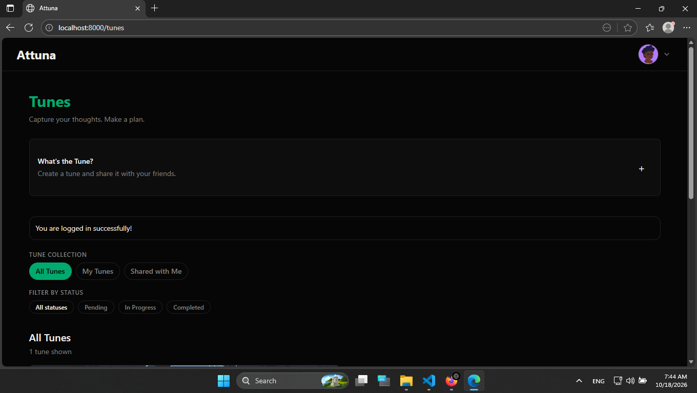
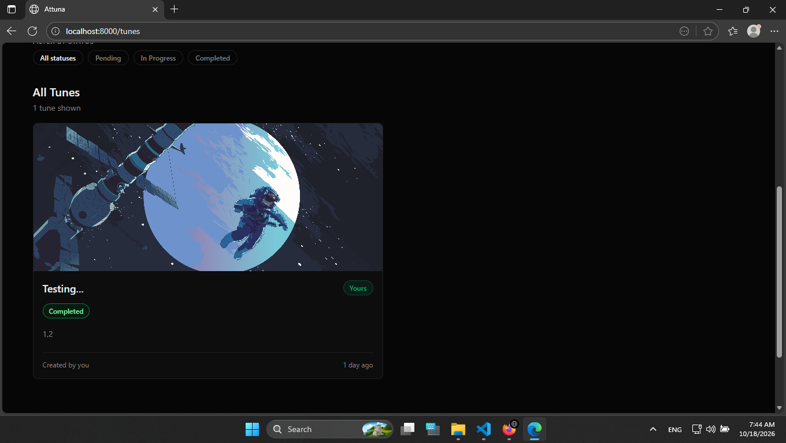
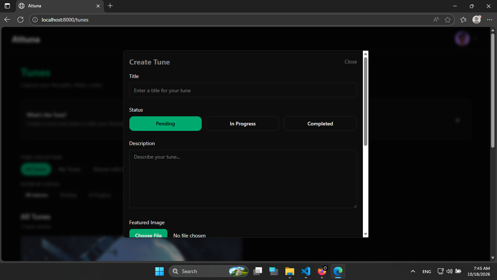
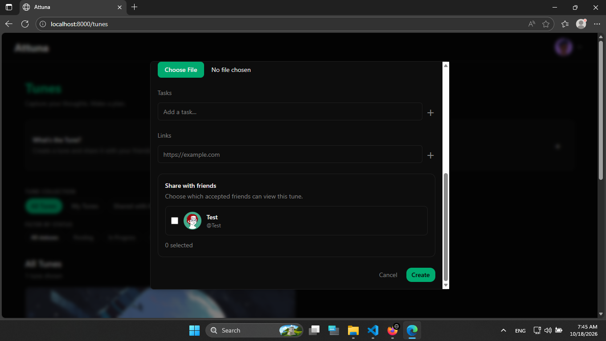
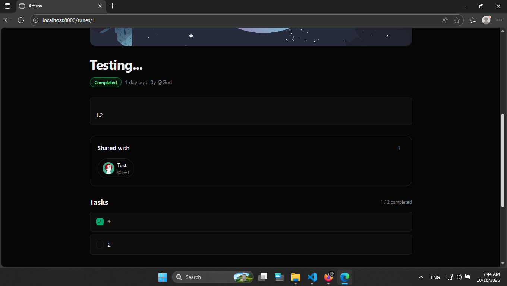
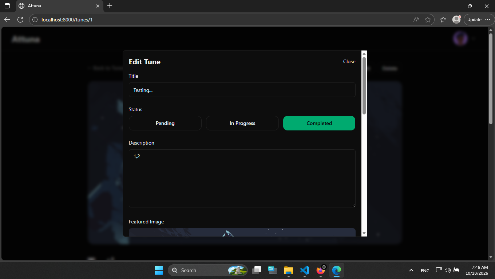

# Attuna

Attuna is a place to capture ideas, turn them into plans, and share them with friends. Create tunes with a status, description, tasks, links, and a featured image, then track progress or browse tunes shared with you.

## Screenshots

### Tune Dashboard
Browse tunes and filter by collection or status.

### Tune Collection
View the tune list and featured images.

### Create a Tune
Set a title, status, description, and featured image.

Add tasks, links, and friends to share the tune with.

### Tune Details
See a tune's description, sharing, and task progress.

### Edit a Tune
Update the tune's details and status.

### Friends
Find people to connect with on Attuna.

Manage your profile and existing connections.

